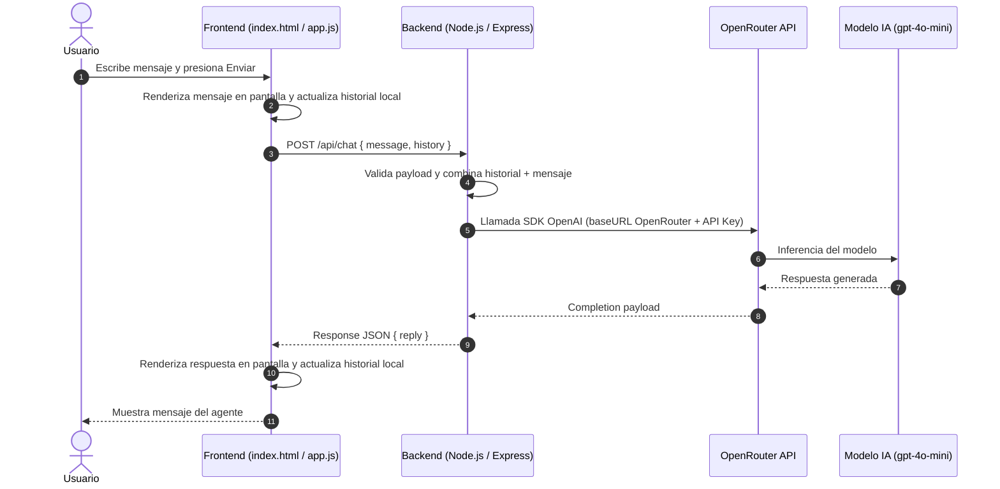

# Plan de Implementación: Integración de un Agente IA en Aplicativo Web (Práctica 6)

---

## 1. Resumen Ejecutivo y Objetivos

### 1.1 Objetivo General
Desarrollar y desplegar una arquitectura cliente-servidor desacoplada que permita a los usuarios finales interactuar mediante un chat web en tiempo real con un modelo de Inteligencia Artificial (LLM), utilizando **Node.js/Express** como middleware seguro y **OpenRouter** como pasarela de modelos.

### 1.2 Objetivos Específicos
1. **Seguridad de Credenciales**: Ocultar la clave de API (`OPENROUTER_API_KEY`) en el backend evitando su exposición en el código cliente.
2. **Backend Intermediario**: Exponer un endpoint REST (`POST /api/chat`) capaz de gestionar el historial de conversación y canalizar las solicitudes a OpenRouter.
3. **Frontend Interactivo**: Implementar una interfaz gráfica limpia y reactiva con HTML5, CSS3 y JavaScript moderno para el intercambio de mensajes.
4. **Gestión de Contexto**: Mantener el hilo conversacional (*multi-turn conversation*) enviando el historial previo en cada mensaje.

---

## 2. Arquitectura de la Solución



### Componentes Clave:
- **Capa Cliente (Frontend)**: Carpeta `ai-frontend` (`index.html`, `app.js`). Corre localmente en el navegador.
- **Capa Servidor (Backend)**: Carpeta `ai-backend` (`server.js`, `.env`, `package.json`). Corre en el puerto `3000`.
- **Capa de Inferencia (Proveedor Externo)**: API de OpenRouter (`https://openrouter.ai/api/v1`), compatible con el cliente SDK de OpenAI.

---

## 3. Requisitos Previos y Herramientas

| Requisito | Descripción | Versión / Estado Requerido |
| :--- | :--- | :--- |
| **Node.js** | Entorno de ejecución JavaScript | v18.x o superior (LTS) |
| **npm** | Gestor de paquetes | v9.x o superior |
| **Cuenta OpenRouter** | Proveedor de acceso a LLMs | Cuenta activa con saldo/crédito |
| **API Key OpenRouter** | Clave secreta de autenticación | Formato `sk-or-v1-...` |
| **Navegador Web** | Cliente para pruebas de interfaz | Chrome, Edge, Firefox o Brave |
| **Editor de Código** | Entorno de desarrollo | VS Code o similar |

---

## 4. Fases de Implementación Paso a Paso

### Fase 1: Preparación del Entorno y Credenciales
- [ ] **Paso 1.1**: Verificar la instalación local de Node.js y npm (`node -v`, `npm -v`).
- [ ] **Paso 1.2**: Generar una API Key en la plataforma [OpenRouter](https://openrouter.ai/settings/keys).
- [ ] **Paso 1.3**: Estructurar las carpetas del proyecto:
  ```text
  proyecto-agente-web/
  ├── ai-backend/
  │   ├── .env
  │   ├── .gitignore
  │   ├── package.json
  │   └── server.js
  └── ai-frontend/
      ├── index.html
      └── app.js
  ```

---

### Fase 2: Construcción del Backend (`ai-backend`)

#### 2.1 Inicialización del Proyecto
1. Abrir terminal y ubicarse en la raíz del backend:
   ```bash
   mkdir ai-backend
   cd ai-backend
   npm init -y
   ```
2. Instalar dependencias requeridas:
   ```bash
   npm install express cors dotenv openai
   ```
   - `express`: Framework para creación del servidor HTTP y enrutamiento.
   - `cors`: Middleware para permitir peticiones cross-origin desde el frontend.
   - `dotenv`: Carga de variables de entorno desde `.env`.
   - `openai`: Cliente oficial compatible con la especificación OpenAI de OpenRouter.

#### 2.2 Configuración de Variables de Entorno
Crear el archivo `.env` en `ai-backend/.env`:
```ini
PORT=3000
OPENROUTER_API_KEY=tu_api_key_de_openrouter_aqui
```

#### 2.3 Implementación de `server.js`
Crear el archivo `ai-backend/server.js`:
```javascript
const express = require('express');
const cors = require('cors');
require('dotenv').config();
const { OpenAI } = require('openai');

const app = express();
app.use(express.json());
app.use(cors());

// Inicializar el cliente de OpenAI apuntando a la baseURL de OpenRouter
const openrouter = new OpenAI({
  baseURL: 'https://openrouter.ai/api/v1',
  apiKey: process.env.OPENROUTER_API_KEY,
  defaultHeaders: {
    'HTTP-Referer': 'https://tu-sitio-web.com', // Opcional para OpenRouter
    'X-Title': 'Mi Aplicativo Web',            // Opcional
  },
});

// Endpoint principal para interactuar con el agente
app.post('/api/chat', async (req, res) => {
  try {
    const { message, history } = req.body;

    if (!message || typeof message !== 'string') {
      return res.status(400).json({ error: 'El mensaje es requerido y debe ser texto.' });
    }

    // Construir el arreglo de mensajes combinando historial y mensaje actual
    const messages = [...(history || []), { role: 'user', content: message }];

    // Llamada a la API a través de OpenRouter
    const completion = await openrouter.chat.completions.create({
      model: 'openai/gpt-4o-mini', // Modelo económico y veloz
      messages: messages,
    });

    const reply = completion.choices[0].message.content;
    res.json({ reply });
  } catch (error) {
    console.error('Error al comunicarse con OpenRouter:', error);
    res.status(500).json({ error: 'Error interno al procesar la solicitud con la IA' });
  }
});

const PORT = process.env.PORT || 3000;
app.listen(PORT, () => {
  console.log(`Servidor corriendo en puerto ${PORT}`);
});
```

#### 2.4 Verificación Rápida del Backend
Iniciar el servidor:
```bash
node server.js
```

---

### Fase 3: Construcción del Frontend (`ai-frontend`)

#### 3.1 Estructura Visual (`index.html`)
Crear el archivo `ai-frontend/index.html`:
```html
<!DOCTYPE html>
<html lang="es">
<head>
  <meta charset="UTF-8">
  <meta name="viewport" content="width=device-width, initial-scale=1.0">
  <title>Chat con Agente IA</title>
  <style>
    * { box-sizing: border-box; }
    body {
      font-family: Arial, sans-serif;
      background: #f4f4f9;
      display: flex;
      justify-content: center;
      height: 100vh;
      align-items: center;
      margin: 0;
    }
    .chat-container {
      width: 420px;
      background: white;
      border-radius: 8px;
      box-shadow: 0 4px 10px rgba(0,0,0,0.1);
      display: flex;
      flex-direction: column;
      overflow: hidden;
      height: 520px;
    }
    .chat-box {
      flex: 1;
      padding: 15px;
      overflow-y: auto;
      display: flex;
      flex-direction: column;
      gap: 10px;
      border-bottom: 1px solid #ddd;
    }
    .message {
      padding: 10px 14px;
      border-radius: 6px;
      max-width: 80%;
      line-height: 1.4;
      word-break: break-word;
    }
    .user {
      background: #007bff;
      color: white;
      align-self: flex-end;
    }
    .assistant {
      background: #e9ecef;
      color: #333;
      align-self: flex-start;
    }
    .input-area {
      display: flex;
      padding: 10px;
      background: #fff;
    }
    .input-area input {
      flex: 1;
      padding: 10px;
      border: 1px solid #ddd;
      border-radius: 4px;
      outline: none;
    }
    .input-area button {
      padding: 10px 15px;
      background: #007bff;
      color: white;
      border: none;
      border-radius: 4px;
      margin-left: 5px;
      cursor: pointer;
      font-weight: bold;
    }
    .input-area button:hover {
      background: #0056b3;
    }
    .input-area button:disabled {
      background: #a0c4ff;
      cursor: not-allowed;
    }
  </style>
</head>
<body>
  <div class="chat-container">
    <div id="chatBox" class="chat-box"></div>
    <div class="input-area">
      <input type="text" id="userInput" placeholder="Escribe tu mensaje..." onkeypress="handleKeyPress(event)">
      <button id="sendBtn" onclick="sendMessage()">Enviar</button>
    </div>
  </div>
  <script src="app.js"></script>
</body>
</html>
```

#### 3.2 Lógica de Cliente (`app.js`)
Crear el archivo `ai-frontend/app.js`:
```javascript
let conversationHistory = [];

async function sendMessage() {
  const inputField = document.getElementById('userInput');
  const chatBox = document.getElementById('chatBox');
  const sendBtn = document.getElementById('sendBtn');
  const text = inputField.value.trim();

  if (!text) return;

  // 1. Mostrar mensaje del usuario en la UI
  appendMessage(text, 'user');
  inputField.value = '';
  chatBox.scrollTop = chatBox.scrollHeight;

  // Agregar al historial local
  conversationHistory.push({ role: 'user', content: text });

  // Bloquear input mientras se espera la respuesta
  inputField.disabled = true;
  if (sendBtn) sendBtn.disabled = true;

  try {
    // 2. Enviar petición al Backend
    const response = await fetch('http://localhost:3000/api/chat', {
      method: 'POST',
      headers: { 'Content-Type': 'application/json' },
      body: JSON.stringify({
        message: text,
        history: conversationHistory.slice(0, -1) // Enviamos el historial previo sin duplicar
      })
    });

    const data = await response.json();

    if (data.reply) {
      // 3. Mostrar respuesta del agente en la UI
      appendMessage(data.reply, 'assistant');
      // Agregar respuesta al historial local
      conversationHistory.push({ role: 'assistant', content: data.reply });
    } else {
      appendMessage('Error: No se pudo obtener respuesta del servidor.', 'assistant');
    }
  } catch (error) {
    console.error('Error de red:', error);
    appendMessage('Error de conexión con el servidor.', 'assistant');
  } finally {
    // Desbloquear input
    inputField.disabled = false;
    if (sendBtn) sendBtn.disabled = false;
    inputField.focus();
    chatBox.scrollTop = chatBox.scrollHeight;
  }
}

function appendMessage(text, sender) {
  const chatBox = document.getElementById('chatBox');
  const messageDiv = document.createElement('div');
  messageDiv.className = `message ${sender}`;
  messageDiv.textContent = text;
  chatBox.appendChild(messageDiv);
}

function handleKeyPress(event) {
  if (event.key === 'Enter') {
    sendMessage();
  }
}
```

---

## 5. Matriz de Pruebas y Validación (End-to-End)

| ID | Caso de Prueba | Acción / Entrada | Resultado Esperado | Criterio de Aceptación |
| :--- | :--- | :--- | :--- | :--- |
| **CP-01** | Inicio Backend | `node server.js` | Log: `Servidor corriendo en puerto 3000` | Proceso activo sin fallos |
| **CP-02** | Mensaje Simple | "Hola, ¿quién eres?" | Respuesta coherente en burbuja gris | HTTP 200 y `reply` presente |
| **CP-03** | Memoria/Contexto | Msg 1: "Me llamo Alex", Msg 2: "¿Cómo me llamo?" | El agente recuerda "Alex" | Envío correcto de `history` |
| **CP-04** | Backend Offline | Detener servidor y enviar mensaje | Mensaje: "Error de conexión con el servidor" | UI captura error con catch |
| **CP-05** | Formato vacío | Clic en Enviar sin texto | No se envía nada al backend | Validación `if (!text) return;` |
| **CP-06** | Tecla Enter | Presionar Enter en el input | Se envía el mensaje automáticamente | Evento `handleKeyPress` funcional |

---

## 6. Buenas Prácticas y Mejoras Recomendadas

1. **Seguridad**: Mantener `.env` en `.gitignore` para no exponer la llave en GitHub o repositorios públicos.
2. **Control de Ventana de Contexto**: Para conversaciones largas, recortar el historial a los últimos 10 o 15 mensajes (`conversationHistory.slice(-10)`) para optimizar consumo de tokens en OpenRouter.
3. **Control CORS en Producción**: Especificar orígenes explícitos (`origin: 'https://midominio.com'`) en vez de comodín abierto.
4. **UX / Loader**: Añadir un indicador de *"El agente está escribiendo..."* mientras llega la respuesta HTTP.

